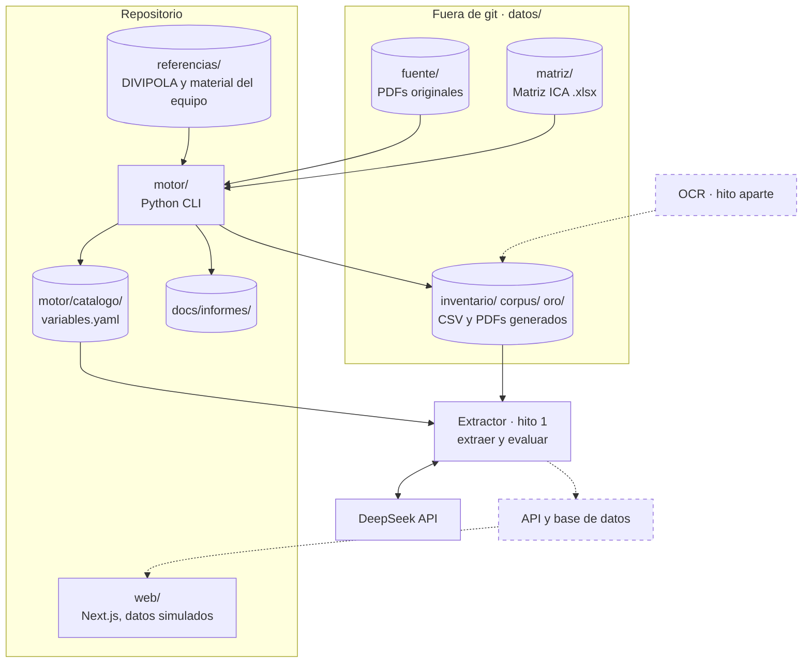
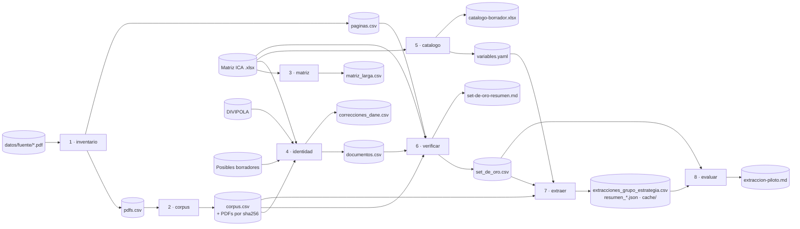
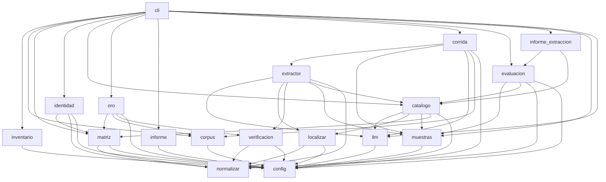
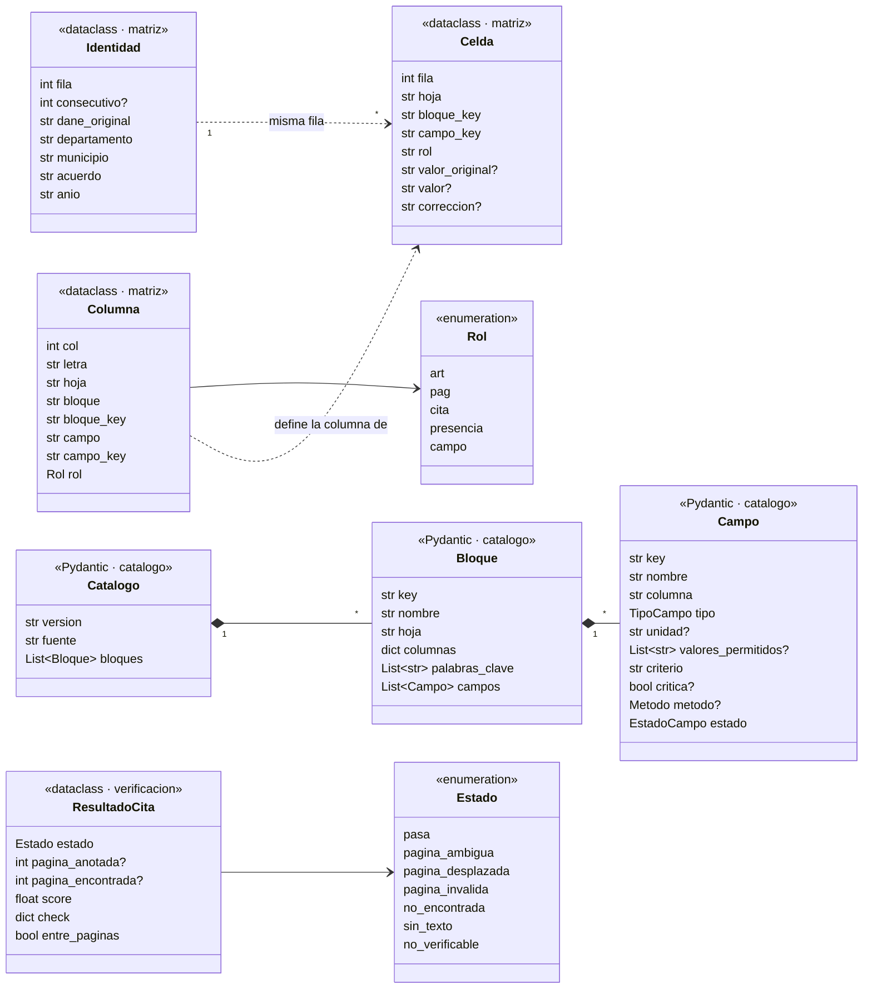
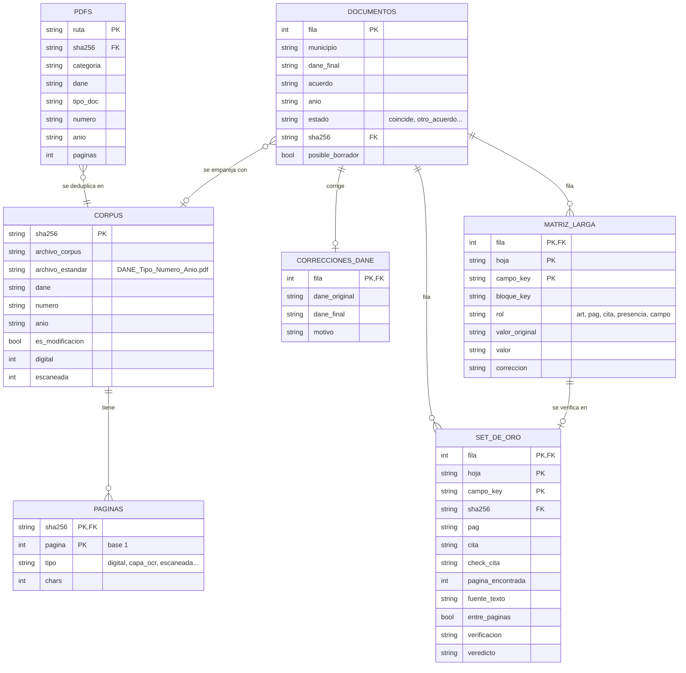
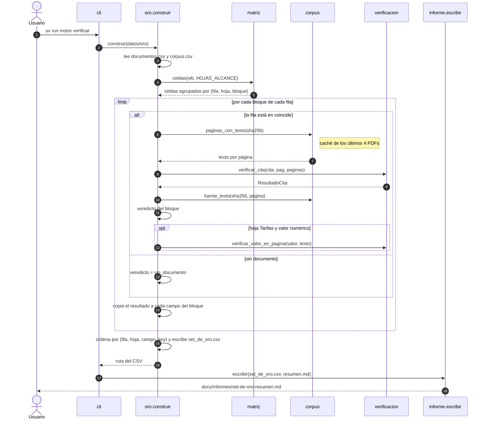
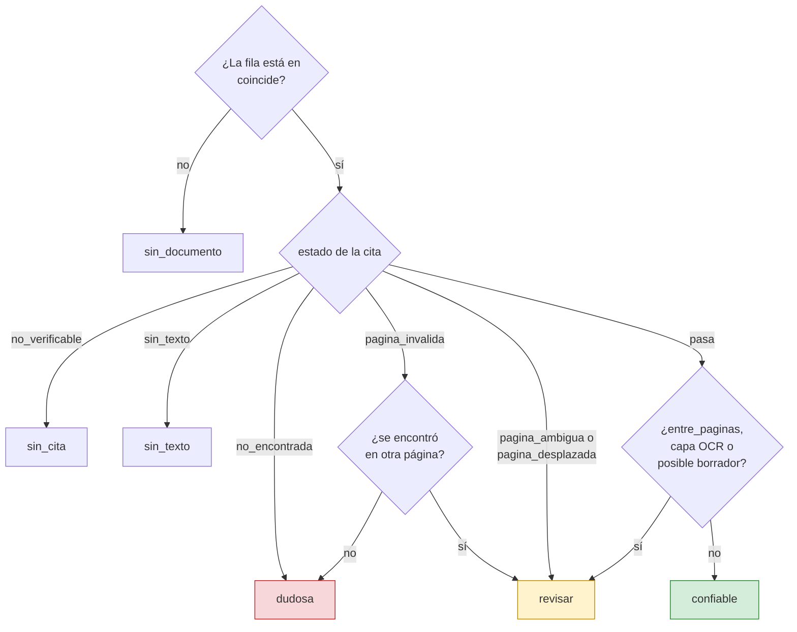
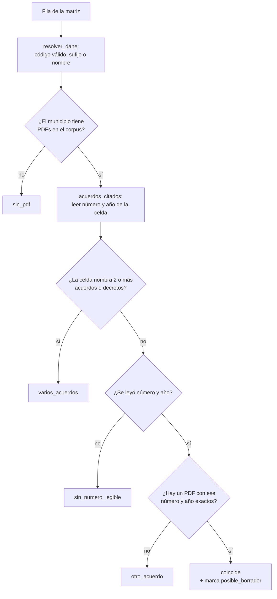
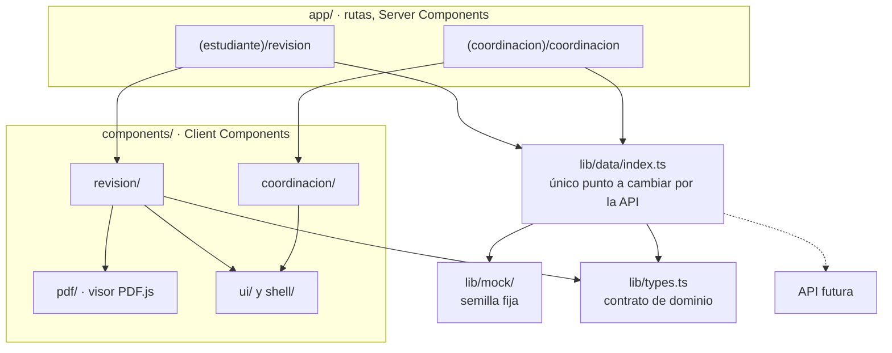

# Diagramas UML

Todos los diagramas están en [Mermaid](https://mermaid.js.org/). GitHub y VS Code (con la extensión de vista previa de Markdown) los dibujan. Reflejan el código al cierre del hito 1 (motor de extracción). Si cambias un módulo, actualiza aquí su diagrama.

1. [Componentes del sistema](#1-componentes-del-sistema)
2. [Flujo del motor](#2-flujo-del-motor)
3. [Dependencias entre módulos](#3-dependencias-entre-módulos)
4. [Clases](#4-clases)
5. [Archivos generados y sus relaciones](#5-archivos-generados-y-sus-relaciones)
6. [Secuencia de `motor verificar`](#6-secuencia-de-motor-verificar)
7. [Decisión del veredicto](#7-decisión-del-veredicto)
8. [Emparejamiento fila → PDF](#8-emparejamiento-fila--pdf)
9. [Capas del frontend](#9-capas-del-frontend)
10. [Secuencia de `extraer_bloque`](#10-secuencia-de-extraer_bloque)

## 1. Componentes del sistema

Las cajas punteadas todavía no existen. El extractor ya existe desde el hito 1.



## 2. Flujo del motor

Cada paso es un subcomando de `uv run motor`. Los cilindros son archivos.



## 3. Dependencias entre módulos

Una flecha `A --> B` significa que A importa B. `config` y `normalizar` son la base. `verificacion` no depende de la matriz, y por eso el extractor del hito 1 lo reutiliza tal cual. `extractor` es el único módulo que junta el modelo (`llm`), la selección de páginas (`localizar`) y la verificación de citas.



## 4. Clases

Son dataclasses (`matriz`, `verificacion`) y modelos Pydantic (`catalogo`). Los atributos que pueden faltar llevan `?`.



## 5. Archivos generados y sus relaciones

`fila` es el número de fila de la matriz Excel, y `sha256` identifica un PDF único.



## 6. Secuencia de `motor verificar`



## 7. Decisión del veredicto

Así decide `oro._veredicto` a partir del `ResultadoCita`, la fuente del texto y si el documento es un posible borrador.



## 8. Emparejamiento fila → PDF

Así decide `identidad.emparejar`. Nunca se sustituye por el acuerdo base ni por el más reciente.



## 9. Capas del frontend

El frontend (`web/`) está construido con datos simulados de estados financieros, y se adapta al dominio en el hito 2. Detalle en [frontend.md](frontend.md).



## 10. Secuencia de `extraer_bloque`

Así procesa `extractor.extraer_bloque` un bloque de un documento. Ningún bloque `ENCONTRADO` sale con una cita que el verificador no halló en el documento.

```mermaid
sequenceDiagram
    autonumber
    participant CO as corrida
    participant EX as extractor.extraer_bloque
    participant LO as localizar
    participant LL as llm.Cliente
    participant VE as verificacion

    CO->>EX: bloque, páginas del PDF, ejemplos, citas de referencia
    EX->>LO: ESTRATEGIAS[estrategia](páginas, citas_ref, palabras_clave)
    LO-->>EX: números de página de contexto
    EX->>EX: armar_mensajes(bloque, contexto, ejemplos)
    loop hasta 2 intentos
        EX->>LL: completar(mensajes)
        Note right of LL: caché en disco; si hay respuesta guardada no cuesta
        LL-->>EX: texto JSON y uso de tokens
        alt JSON inválido o cortado
            EX->>EX: pide de nuevo un JSON válido y más corto
        else NO_ENCONTRADO
            EX-->>CO: rojo, sin valores
        else ENCONTRADO
            EX->>VE: verificar_cita(cita, página, páginas)
            VE-->>EX: ResultadoCita
            opt la cita no aparece
                EX->>EX: pide copiarla literal o responder NO_ENCONTRADO
            end
        end
    end
    alt cita no hallada tras 2 intentos
        EX-->>CO: rojo, NO_ENCONTRADO
    else cita hallada
        EX->>VE: verificar_valor_en_pagina(valor, texto) por cada campo numérico
        VE-->>EX: pasa, alerta o falla
        EX-->>CO: Extraccion con semáforo verde o amarillo
    end
```
