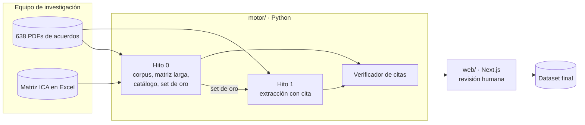
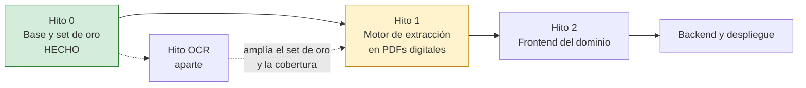

# Visión general

## El problema

Cada municipio de Colombia regula el ICA con uno o varios **acuerdos del concejo municipal**: quién paga, qué actividades no pagan y qué tarifas aplica. El equipo de investigación de Contaduría de las UTS reunió **638 PDFs únicos** de esos acuerdos (509 municipios, 105.818 páginas). Con ellos, los estudiantes llenaron a mano una **matriz Excel** de 508 filas (una por municipio y acuerdo) y unas 850 columnas.

Llenarla a mano trae tres problemas:

- **Errores de digitación:** casillas Sí/No invertidas, valores en el campo equivocado, citas recortadas.
- **Datos sin respaldo:** parte de las citas no aparece en el PDF.
- **Escaneos:** cerca de la mitad de los PDFs emparejados son imágenes sin texto.

## La solución, en una frase

Un pipeline que lee cada acuerdo, extrae los campos del catálogo **con su cita y su página**, **verifica por código** que la cita exista, y deja a los estudiantes solo la revisión.

## Las piezas

| Pieza | Carpeta | Tecnología | Estado |
|---|---|---|---|
| Motor | `motor/` | Python 3.12, uv, PyMuPDF, RapidFuzz, openpyxl, Pydantic | Hito 0 hecho: set de oro |
| Interfaz de revisión | `web/` | Next.js 16, React 19, Tailwind 4, PDF.js | Construida con datos simulados de estados financieros |
| Datos | `datos/` (fuera de git) | PDFs, Excel, CSV | Corpus y set de oro generados |
| Referencias | `referencias/` | Excel y Word del equipo | DIVIPOLA y material de trabajo |

## Principios que no se negocian

1. **Ningún dato sin cita y página.** Si no se encuentra, queda `NO_ENCONTRADO`; nunca se inventa.
2. **La confianza la da el código, no el modelo.** Se comprueba que la cita esté en la página, que el valor salga de la cita y que el formato sea válido.
3. **Reproducible.** Desde los archivos fuente, un comando regenera todo y el resultado sale idéntico.
4. **El original no se toca.** `datos/fuente/` y la matriz son de solo lectura. Toda corrección queda registrada con su motivo.

## Hitos

- **Hito 0, base y set de oro (hecho).** Ver [motor.md](motor.md).
- **Hito 1, motor de extracción.** Recibe un PDF digital y devuelve los campos del catálogo, cada uno con artículo, página y cita. Se mide contra los datos `confiable` del set de oro, y el verificador revisa sus citas.
- **Hito 2, frontend del dominio.** Adaptar `web/` a acuerdos tributarios, con la cita y su página a la vista para aprobar o corregir.
- **Hito OCR, aparte.** El extractor recibe texto página por página sin importar de dónde sale, así que el OCR se conecta después sin cambiar nada más.

## Preguntas abiertas con el equipo de contaduría

- **P1:** ¿en qué unidad van las tarifas (¿por mil?) y qué significa el `0`?
- **P2:** ¿qué hacer con las 51 filas que citan varios acuerdos?
- Revisión del catálogo borrador: [`docs/informes/catalogo-borrador.xlsx`](../informes/catalogo-borrador.xlsx).
- Limpieza de `datos/fuente/`: propuesta en [base-datos-fuente.md](../datos/base-datos-fuente.md), sin aprobar.
